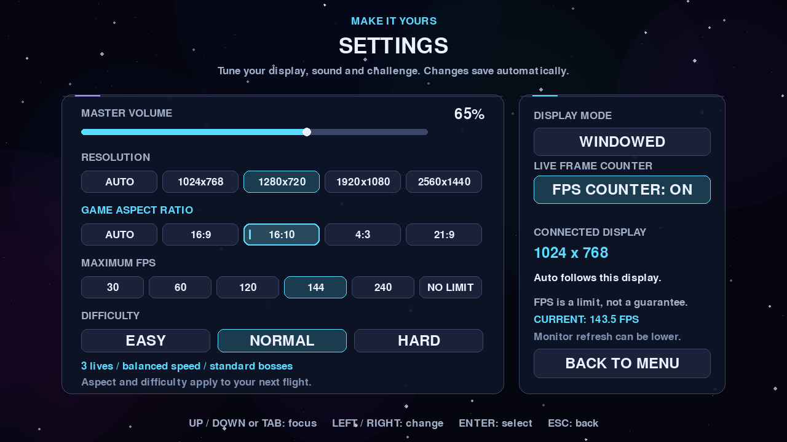
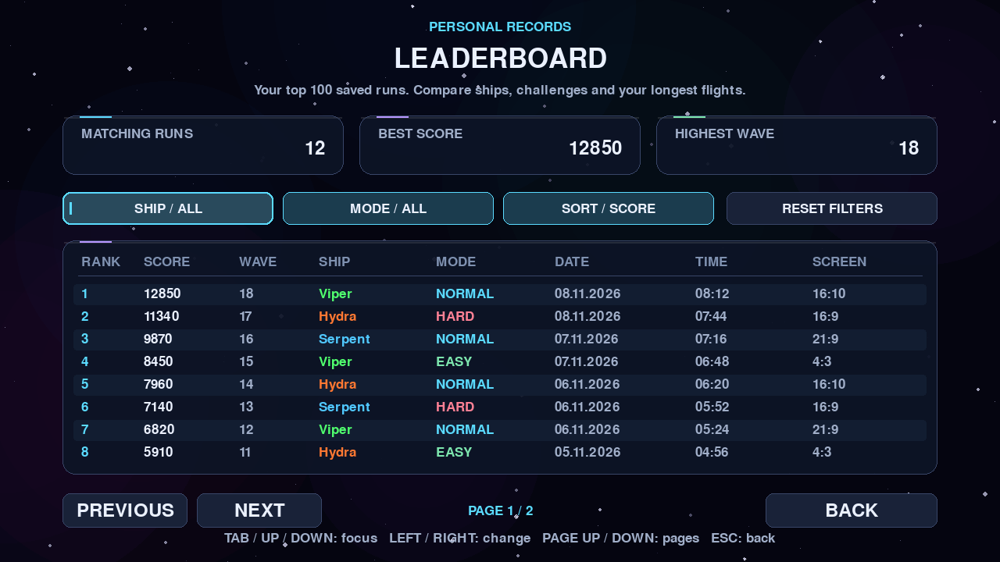
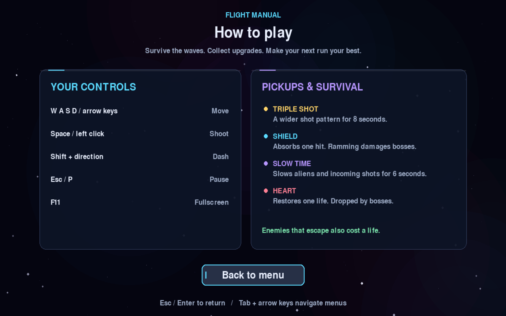
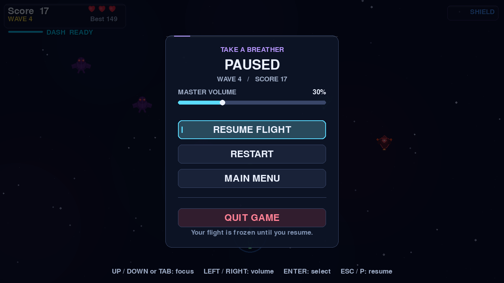

# Serpentis

**Current release:** [Serpentis 1.9.0](https://github.com/Curun1r/Serpentis/releases/tag/serpentis_1.9.0)

A fast-paced 2-D space shooter built with Python and pygame.  
Destroy waves of alien invaders, survive boss encounters, collect power-ups, and chase the high score.

---

## Download

**No Python required — just download and play.**

| Platform | Download |
|----------|----------|
| 🪟 Windows | [Serpentis-Windows.exe](https://github.com/Curun1r/Serpentis/releases/latest/download/Serpentis-Windows.exe) |
| 🍎 macOS | [Serpentis-macOS.zip](https://github.com/Curun1r/Serpentis/releases/latest/download/Serpentis-macOS.zip) |
| 🐧 Linux | [Serpentis-Linux.tar.gz](https://github.com/Curun1r/Serpentis/releases/latest/download/Serpentis-Linux.tar.gz) |

Or browse all releases → **[github.com/Curun1r/Serpentis/releases](https://github.com/Curun1r/Serpentis/releases)**

> **macOS note:** after unzipping, right-click `Serpentis.app` → Open (first launch only, to bypass Gatekeeper).  
> **Linux note:** extract the archive, then `chmod +x Serpentis && ./Serpentis`.

---

## Screenshots

Gameplay and interface previews. Leaderboard examples use demonstration runs.

<table>
  <tr>
    <td></td>
    <td></td>
  </tr>
  <tr>
    <td align="center"><em>Main Menu</em></td>
    <td align="center"><em>Ship Selection</em></td>
  </tr>
  <tr>
    <td></td>
    <td></td>
  </tr>
  <tr>
    <td align="center"><em>Gameplay</em></td>
    <td align="center"><em>Boss Fight</em></td>
  </tr>
  <tr>
    <td></td>
    <td></td>
  </tr>
  <tr>
    <td align="center"><em>Run Summary</em></td>
    <td align="center"><em>Settings</em></td>
  </tr>
  <tr>
    <td></td>
    <td></td>
  </tr>
  <tr>
    <td align="center"><em>Personal Records</em></td>
    <td align="center"><em>How to Play</em></td>
  </tr>
  <tr>
    <td></td>
    <td></td>
  </tr>
  <tr>
    <td align="center"><em>Pause Menu</em></td>
    <td></td>
  </tr>
</table>

---

## Features

- **Endless wave system** — waves get harder every round (+1 alien, +15% speed per wave)
- **4 alien types** — Normal, Armoured (multi-hit), Zigzag, and Shooter aliens that fire back
- **Mini-boss encounters** — a fast raider appears every wave 3, 8, 13 …
- **Full boss fights** — every 5th wave; three visual tiers (Phantom → Ravager → Leviathan) each with unique multi-phase attack patterns
- **3 playable ships** — each with unique procedurally-drawn sprites, stats, and dash timing; a cobalt Serpent interceptor, emerald Viper and armoured amber Hydra share a detailed fleet style with paired engine trails
- **Dash mechanic** — short-range burst in any direction with a cooldown bar
- **4 power-ups** — Triple Shot, Shield (absorbs one hit + sound), Slow Time, Heart (+1 life)
- **Floating damage numbers** — real-time score and hit feedback above every enemy
- **Visual effects** — particle explosions, engine trail, camera shake, shield ring, slow-time tint
- **Procedural audio** — every sound generated at runtime via numpy (no audio files required)
- **Top-100 personal leaderboard** — filter by ship and difficulty, sort by score, wave or date, and browse eight runs per page; each run records its date, duration and game aspect ratio
- **Settings** — volume, automatic or manual resolution, game aspect ratio, maximum FPS, live FPS counter, difficulty and fullscreen
- **Keyboard-friendly menus** — shared focus states, readable panels, and an in-game How to Play guide
- **Automatic Mac display mode** — follows the current monitor and respects macOS display scaling; manual resolution remains available
- **Selectable game aspect ratio** — Auto, 16:9, 16:10, 4:3 or 21:9 change the playfield width without stretching ships; menus retain their 1280×720 layout and mouse input follows the active viewport
- **Precise frame pacing** — 30, 60, 120, 144 or 240 FPS caps and a No Limit option, with a measured frame counter

---

## Ships

| Ship | Style | Speed | Firepower | Dash |
|------|-------|:-----:|:---------:|:----:|
| **Serpent** | Balanced | ●●●●●●○○○○ | ●●●●●○○○○○ | ●●●●●●○○○○ |
| **Viper** | Speed & agility | ●●●●●●●●●○ | ●●●●○○○○○○ | ●●●●●●●●●○ |
| **Hydra** | Heavy firepower | ●●●●○○○○○○ | ●●●●●●●●●○ | ●●●●○○○○○○ |

---

## Controls

| Key | Action |
|-----|--------|
| `←` `→` `↑` `↓` or `WASD` | Move |
| `Space` or Left Click | Shoot |
| `Shift` | Dash |
| `P` / `Esc` | Pause |
| `F11` | Toggle fullscreen |

In menus, use `Up` / `Down` or `Tab` to navigate and `Enter` to select. Settings use `Left` / `Right` to adjust the focused row. In the hangar, use `Left` / `Right` to choose a ship and `Enter` to launch. Open **How to Play** from the main menu for controls and pickup descriptions.

On macOS, **AUTO** resolution is enabled by default. Fullscreen uses the current monitor's desktop resolution; windowed mode leaves room for the system menu bar and Dock. The game adapts when moved to another monitor and keeps its proportions. Choose a fixed resolution in Settings to disable Auto.

**Game aspect ratio** is separate from the window resolution. Choose **Auto**, **16:9**, **16:10**, **4:3** or **21:9** to set the playfield for your next flight. Auto uses the connected display's proportions, within the supported 4:3 to 32:9 range. The camera width changes while ships keep their proportions; any unused window area is letterboxed. The default remains 16:9. Aspect and difficulty changes take effect when you start or retry a flight.

**Maximum FPS** applies immediately: choose **30**, **60**, **120**, **144**, **240** or **No Limit** (`0` as the frame cap). The live counter reports measured rendering FPS in Settings and during play. A cap is a maximum, so demanding scenes or slower hardware can run below it. Rendering FPS and monitor refresh rate are different: a 60 Hz monitor cannot display 144 distinct frames each second.

Open **Leaderboard** from the main menu or **All Records** after a flight. Filter by ship or difficulty, sort by score, highest wave or newest date, and use **Page Up / Page Down**, the mouse wheel or the page buttons to browse. Existing scores remain available; older runs without duration metadata show `--:--`.

---

## Installation

**Requirements:** Python 3.10 or newer. Python 3.12 is used for desktop releases.
Internet access is needed for the first source setup or when dependencies change.

```bash
git clone https://github.com/Curun1r/Serpentis.git
cd Serpentis
```

**Source launchers:**

| Platform | Launch |
|----------|--------|
| macOS | double-click `run.command` |
| Linux | `bash run.sh` |
| Windows | double-click `run.bat` |

The launchers prepare a project-local `.venv`, install the complete dependency list there,
and reuse it on later runs. They do not install packages into the system Python and do not require Pipenv.
An existing valid `.venv` (including a symlink to a Pipenv environment) is preserved.
The launcher stops if setup fails; it never starts the game with a failed installation.

**Setup without opening the game:**

```bash
python3 launcher.py --setup
python3 launcher.py --check
```

On Windows, use `python` in place of `python3`, or run `run.bat --setup` / `run.bat --check`.
The same options work with `run.command` and `run.sh`.
After setup, the source launchers work offline while the dependency list remains unchanged.
`--check` makes no changes and returns a nonzero exit code if setup or repair is needed.

**PyCharm:** open this folder, select `.venv/bin/python` on macOS/Linux or
`.venv\Scripts\python.exe` on Windows as the project interpreter, and run `main.py`.
If the environment is missing, run the source launcher once or use `launcher.py --setup` first.
The game resolves its images, configuration and saves independently of PyCharm's working directory.

**Manual environment:**

```bash
python3 -m venv .venv
.venv/bin/python -m pip install -r requirements.txt
.venv/bin/python main.py
```

On Windows, use `.venv\Scripts\python.exe` for the last two commands.
Pipenv remains an optional alternative: `pipenv install` followed by `pipenv run python main.py`.

## Startup checks and releases

A bounded check starts the real game with invisible SDL drivers, renders all nine screens,
loads bundled images, generates audio, and verifies settings and scores in disposable save data:

```bash
.venv/bin/python main.py --smoke-test --smoke-report startup-report.json
```

The report includes the application/version and success status. This check leaves player saves untouched.
Normal startup failures are recorded in `data/startup.log` for source runs, or in the application's
per-user save folder for desktop builds. Source saves stay in this project's `data/` directory regardless
of the working directory. Packaged saves remain in:

- macOS: `~/Library/Application Support/Serpentis/`
- Windows: `%APPDATA%\Serpentis\`
- Linux: `$XDG_DATA_HOME/Serpentis/`, or `~/.local/share/Serpentis/` by default.

`SERPENTIS_DATA_DIR` can explicitly select another save folder for isolated testing.
If source setup fails, check the launcher's error message and retry `--setup` after fixing the cause.
An incomplete `.venv` is reported rather than overwritten; preserve any files you need before replacing it.

CI checks Windows, macOS and Linux on Python 3.12, plus the Python 3.10 minimum on Linux.
On all three platforms it also tests the source launcher from a clean copy in a path with spaces,
including first setup, dependency checks, and reuse of the prepared environment.
Release builds must pass `scripts/verify_build.py` against the actual executable, from an unrelated
working directory, before they are archived or uploaded. Every new release also includes
`SHA256SUMS.txt` for its three desktop downloads.

Before publishing, update `APP_VERSION` in `app_info.py` and `RELEASE_NOTES.md`, then tag the matching
commit with `serpentis_<version>`. A manual **Build & Release** run on a branch creates test artifacts
without publishing a release. No release is created by an ordinary commit or branch push.

---

## Configuration

Copy the example config to customise speeds, scales, or the window title:

```bash
cp config.example.json config.json
```

`config.json` is gitignored — changes stay local.

---

## Project structure

```
main.py              — entry point, startup diagnostics and bounded smoke check
launcher.py          — isolated source setup and launch for all platforms
app_info.py          — shared application name, tagline, and release version
game.py              — main loop, state machine, collision logic
fighter.py           — player ship (movement, dash)
alien.py             — Alien, ArmoredAlien, ZigzagAlien, ShooterAlien
boss.py              — Boss and MiniBoss with phase-based attacks
ball.py              — player bullet
alien_bullet.py      — enemy bullet
powerup.py           — TripleShot, Shield, SlowTime, Heart pick-ups
explosion.py         — explosion animation sprite
ship.py              — ShipConfig definitions (Serpent / Viper / Hydra)
ship_sprites.py      — procedural ship sprite builder
ui_fx.py             — glass panels, damage numbers, glow effects
ui_theme.py          — shared menu colors, buttons, focus, and leaderboard
display_layout.py    — monitor detection, automatic sizing, proportional viewport
frame_timing.py      — precise FPS limits and measured frame rate
score_manager.py     — top-100 records, validation, filters and atomic JSON saves
settings_manager.py  — display, aspect, FPS, sound and difficulty preferences (JSON)
assets.py            — image / sound cache + procedural audio
music.py             — procedural background music player
background.py        — parallax star field
config.py            — runtime constants (loaded from project config.json)
paths.py             — source/bundled resources and persistent save locations
scripts/             — built-executable verification and release checksums
screens/             — main menu, hangar, results, leaderboard, pause, settings, controls
tests/               — pytest suite for logic and headless gameplay regressions
```

---

## License

[MIT](LICENSE) © Yehor Petrenko
