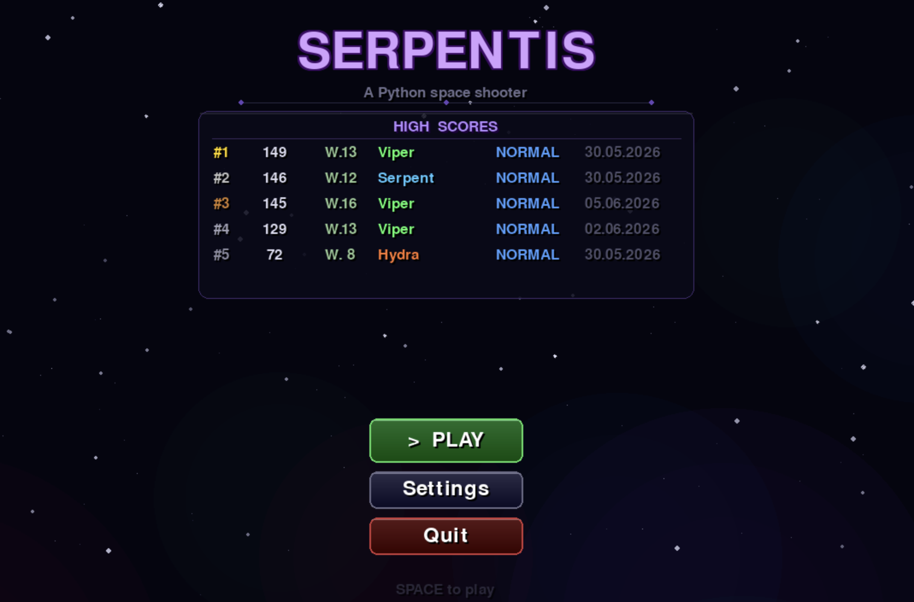
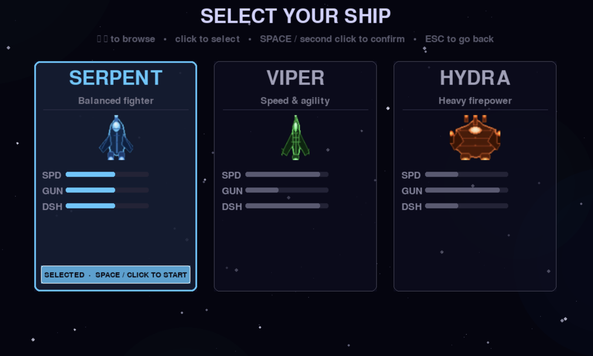
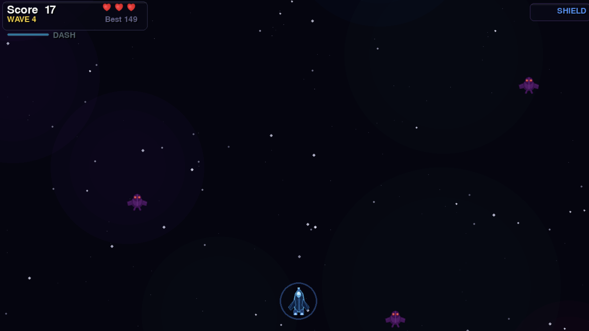
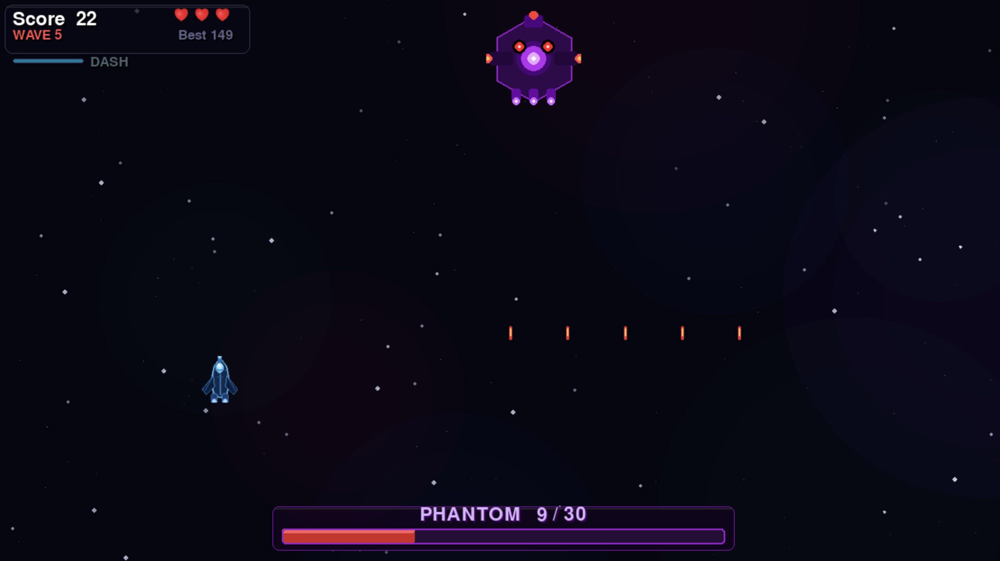
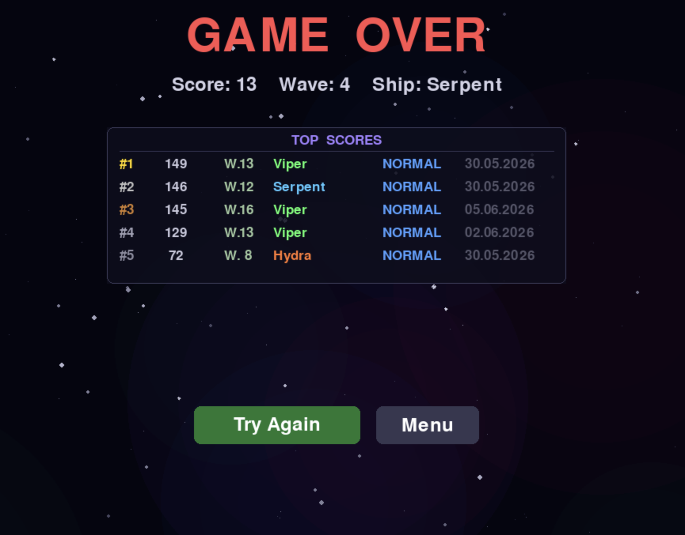

# Serpentis

A fast-paced 2-D space shooter built with Python and pygame.  
Destroy waves of alien invaders, survive boss encounters, collect power-ups, and chase the high score.

---

## Screenshots

<table>
  <tr>
    <td></td>
    <td></td>
  </tr>
  <tr>
    <td align="center"><em>Main Menu</em></td>
    <td align="center"><em>Ship Selection</em></td>
  </tr>
  <tr>
    <td></td>
    <td></td>
  </tr>
  <tr>
    <td align="center"><em>Gameplay</em></td>
    <td align="center"><em>Boss Fight</em></td>
  </tr>
  <tr>
    <td></td>
    <td></td>
  </tr>
  <tr>
    <td align="center"><em>Game Over & Leaderboard</em></td>
    <td></td>
  </tr>
</table>

---

## Features

- **Endless wave system** — waves get harder every round (+1 alien, +15% speed per wave)
- **4 alien types** — Normal, Armoured (multi-hit), Zigzag, and Shooter aliens that fire back
- **Mini-boss encounters** — a fast raider appears every wave 3, 8, 13 …
- **Full boss fights** — every 5th wave; three visual tiers (Phantom → Ravager → Leviathan) each with unique multi-phase attack patterns
- **3 playable ships** — each with unique procedurally-drawn sprites, stats, and dash timing
- **Dash mechanic** — short-range burst in any direction with a cooldown bar
- **4 power-ups** — Triple Shot, Shield (absorbs one hit + sound), Slow Time, Heart (+1 life)
- **Floating damage numbers** — real-time score and hit feedback above every enemy
- **Visual effects** — particle explosions, engine trail, camera shake, shield ring, slow-time tint
- **Procedural audio** — every sound generated at runtime via numpy (no audio files required)
- **Top-5 leaderboard** — persisted to disk, shown on the game-over screen
- **Settings** — volume, resolution (1024×768 → 2560×1440), difficulty, fullscreen
- **Sharp on HiDPI / Retina** — fixed 1280×720 logical canvas scaled via `pygame.SCALED`

---

## Ships

| Ship | Style | Speed | Firepower | Dash |
|------|-------|:-----:|:---------:|:----:|
| **Serpent** | Balanced | ●●●●●●○○○○ | ●●●●●○○○○○ | ●●●●●●○○○○ |
| **Viper** | Speed & agility | ●●●●●●●●●○ | ●●●●○○○○○○ | ●●●●●●●●●○ |
| **Hydra** | Heavy firepower | ●●●●○○○○○○ | ●●●●●●●●●○ | ●●●●○○○○○○ |

---

## Controls

| Key | Action |
|-----|--------|
| `←` `→` `↑` `↓` or `WASD` | Move |
| `Space` or Left Click | Shoot |
| `Shift` | Dash |
| `P` / `Esc` | Pause |
| `F11` | Toggle fullscreen |

---

## Installation

**Requirements:** Python 3.10+ and pygame 2.5+

```bash
git clone https://github.com/SaruUa/Space-shooter.git
cd Space-shooter
```

**With pip:**
```bash
pip install -r requirements.txt
python main.py
```

**With pipenv:**
```bash
pipenv install
pipenv run python main.py
```

**One-click launchers:**

| Platform | File |
|----------|------|
| macOS | double-click `run.command` |
| Linux | `bash run.sh` |
| Windows | double-click `run.bat` |

---

## Configuration

Copy the example config to customise speeds, scales, or the window title:

```bash
cp config.example.json config.json
```

`config.json` is gitignored — changes stay local.

---

## Project structure

```
main.py              — entry point
game.py              — main loop, state machine, collision logic
fighter.py           — player ship (movement, dash)
alien.py             — Alien, ArmoredAlien, ZigzagAlien, ShooterAlien
boss.py              — Boss and MiniBoss with phase-based attacks
ball.py              — player bullet
alien_bullet.py      — enemy bullet
powerup.py           — TripleShot, Shield, SlowTime, Heart pick-ups
explosion.py         — explosion animation sprite
ship.py              — ShipConfig definitions (Serpent / Viper / Hydra)
ship_sprites.py      — procedural ship sprite builder
ui_fx.py             — glass panels, damage numbers, glow effects
score_manager.py     — top-5 leaderboard (JSON)
settings_manager.py  — volume, resolution, difficulty, fullscreen (JSON)
assets.py            — image / sound cache + procedural audio
music.py             — procedural background music player
background.py        — parallax star field
config.py            — runtime constants (loaded from config.json)
screens/             — start, ship select, game over, pause, settings
```

---

## License

[MIT](LICENSE) © Yehor Petrenko
